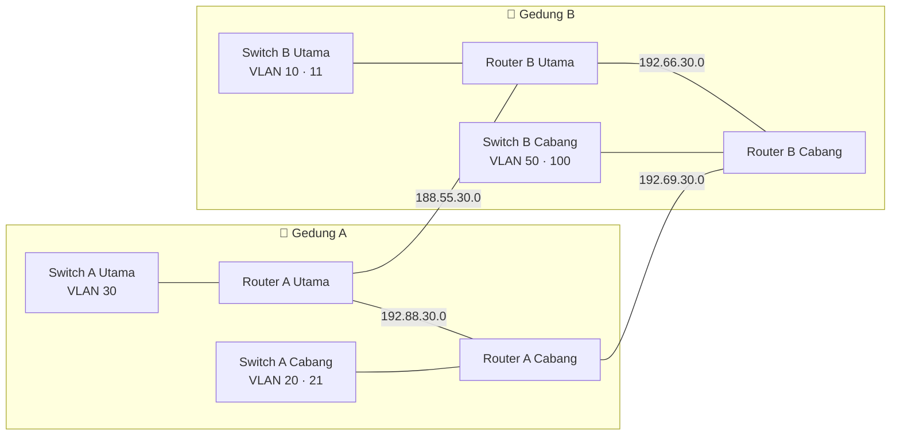

<div align="center">

# 🌐 Two-Building Enterprise Network

### Cisco Packet Tracer · 4 Routers · Multi-VLAN · RIPv2 · VoIP · Wireless · ACL


<br>


<sub>Full topology built in Cisco Packet Tracer</sub>

</div>

---

## 📑 Table of Contents

[Overview](#-overview) · [Highlights](#-highlights) · [Topology](#%EF%B8%8F-topology) · [VLAN Plan](#-vlan--subnet-plan) · [WAN Links](#-wan-links) · [ACL](#%EF%B8%8F-access-control-list) · [Configs](#-device-configurations) · [Testing](#-verification--testing) · [Structure](#-repository-structure)

---

## 📖 Overview

This project simulates an enterprise network across **two buildings (Gedung A and Gedung B)**. Each building has a **main (Utama)** zone and a **branch (Cabang)** zone, each with its own router and switch.

The four routers are linked in a **serial WAN ring** and share routes dynamically with **RIPv2**, so the network keeps working if one link fails. Inside each zone, traffic is split into **VLANs** and routed with **router-on-a-stick**.

## ✨ Highlights

| | | |
|:---:|:---:|:---:|
| 🔀 **4 Routers**<br>serial WAN ring | 🧩 **7 VLANs**<br>10 · 11 · 20 · 21 · 30 · 50 · 100 | 🛣️ **RIPv2**<br>dynamic routing |
| 📞 **VoIP**<br>IP Phones with telephony-service | 📶 **Wireless**<br>access points in both buildings | 🗂️ **DHCP**<br>automatic addressing per VLAN |
| 🖥️ **DNS Server**<br>centralized in Gedung B | 🛡️ **ACL**<br>traffic filtering | 🔁 **Redundancy**<br>ring keeps an alternate path |

---

## 🗺️ Topology

### Packet Tracer view


<details>
<summary><b>🎨 Clean diagram view (click to expand)</b></summary>
<br>

</details>

### Logical view



### Zones

| Building | Zone | Router | Switch |
|:--------:|:----:|--------|--------|
| A | Utama | Router Gedung A Utama | Switch Gedung A Utama |
| A | Cabang | Router A Utama Cabang | Switch Gedung A Cabang |
| B | Utama | Router Gedung B Utama | Switch Gedung B Utama |
| B | Cabang | Router Gedung B Cabang | Switch Gedung B Cabang |

---

## 📋 VLAN & Subnet Plan

| Color | Building | Zone | VLAN | Subnet | Devices |
|:-----:|:--------:|:----:|:----:|--------|---------|
| 🟩 | A | Utama | **30** | `192.44.30.0` | PC0, PC1, PC2 |
| 🟪 | A | Cabang | **20** | `198.32.30.0` | Smartphone0, Laptop0 (Wi-Fi via AP) |
| 🟦 | A | Cabang | **21** | `197.73.30.0` | PC3, PC4, PC5 |
| 🟥 | B | Utama | **10** | `192.29.30.0` | Printer0 |
| 🟨 | B | Utama | **11** | `100.100.30.0` | Server0 (DNS) |
| 🟧 | B | Cabang | **50** | `192.123.30.0` | Tablet PC0, Smartphone1 (Wi-Fi via AP) |
| 🔷 | B | Cabang | **100** | `200.20.30.0` | IP Phone0, IP Phone1, IP Phone2 |

> 💡 The colors match the colored groups in the Packet Tracer topology. IP ranges are lab addresses and do not follow RFC 1918.

<!-- TODO: add the subnet mask for each VLAN (for example /24) -->

## 🔗 WAN Links

| Link | Subnet | Type |
|------|--------|:----:|
| Router A Utama ↔ Router B Utama | `188.55.30.0` | Serial |
| Router A Utama ↔ Router A Cabang | `192.88.30.0` | Serial |
| Router B Utama ↔ Router B Cabang | `192.66.30.0` | Serial |
| Router A Cabang ↔ Router B Cabang | `192.69.30.0` | Serial |

---

## ⚙️ Technologies

| Technology | What it does here |
|------------|-------------------|
| **VLAN & 802.1Q trunk** | Separates data, wireless, server, and voice traffic |
| **Router-on-a-stick** | Inter-VLAN routing with sub-interfaces |
| **RIPv2** | Dynamic routing between the four routers |
| **DHCP** | Automatic IP, gateway, and DNS per VLAN |
| **Telephony Service** | IP Phone registration and extension calls |
| **Access Points** | Wireless access for phones, laptops, and tablets |
| **DNS Server** | Name resolution inside the network |

## 🛡️ Access Control List

<!-- TODO: fill in your real ACL, or delete this section -->

| ACL | Applied On | Purpose |
|-----|------------|---------|
| ... | ... | ... |

---

## 🔧 Device Configurations

All device configs are in the [`configs/`](configs/) folder.

<details>
<summary><b>🔀 Routers</b></summary>

- [Router Gedung A Utama](configs/Router-A-Utama.txt)
- [Router A Utama Cabang](configs/Router-A-Cabang.txt)
- [Router Gedung B Utama](configs/Router-B-Utama.txt)
- [Router Gedung B Cabang](configs/Router-B-Cabang.txt)

</details>

<details>
<summary><b>🧱 Switches</b></summary>

- [Switch Gedung A Utama](configs/Switch-A-Utama.txt)
- [Switch Gedung A Cabang](configs/Switch-A-Cabang.txt)
- [Switch Gedung B Utama](configs/Switch-B-Utama.txt)
- [Switch Gedung B Cabang](configs/Switch-B-Cabang.txt)

</details>

<!-- Rename the links above to match your real file names in configs/ -->

---

## ✅ Verification & Testing

| Test | Command / Method | Expected result |
|------|------------------|-----------------|
| VLAN & ports | `show vlan brief` | Ports are in the correct VLAN |
| Trunks | `show interfaces trunk` | Trunk ports carry the needed VLANs |
| Routing table | `show ip route` | All subnets learned via RIP (`R`) |
| RIP status | `show ip protocols` | RIPv2 active, networks advertised |
| DHCP | Set a PC to DHCP | PC gets IP, gateway, and DNS |
| Connectivity | `ping` between buildings | Replies from the other building and the server |
| VoIP | Call between two IP Phones | Call connects between extensions |
| DNS | Open the server name from a PC | Name resolves to the server IP |

## 📁 Repository Structure

```
.
├── README.md
├── images/
│   ├── topologi.png            # Packet Tracer screenshot
│   └── topologi-diagram.png    # clean diagram
├── configs/
│   ├── Router-*.txt
│   └── Switch-*.txt
└── packet-tracer/
    └── network-simulation.pkt
```

## 🚀 How to Run

1. Install [Cisco Packet Tracer](https://www.netacad.com/cisco-packet-tracer).
2. Open the `.pkt` file in `packet-tracer/`.
3. Wait until all links turn green, then run the tests above.

---

<div align="center">

### 👤 Author

**Revan Anugrah Wibowo**
Network Engineering student (TJKT) · SMKN 3 Kota Tangerang

[](https://www.linkedin.com/in/revan-anugrah-wibowo/)
[](https://github.com/RevanAnugrah)

⭐ If this project helps you, give it a star!

</div>
