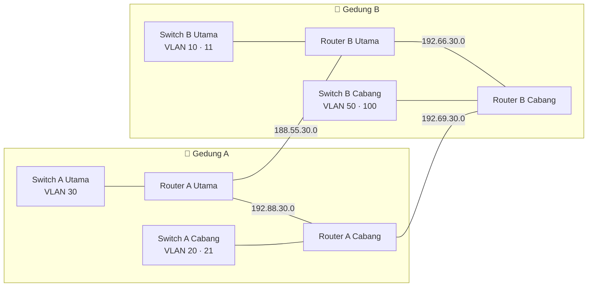

<div align="center">

# 🌐 Two-Building Enterprise Network

### Cisco Packet Tracer · 4 Routers · Multi-VLAN · RIPv2 · VoIP · Wireless · ACL


<br>


<sub>Full topology built in Cisco Packet Tracer</sub>

</div>

---

## 📑 Table of Contents

[Overview](#-overview) · [Highlights](#-highlights) · [Topology](#%EF%B8%8F-topology) · [VLAN Plan](#-vlan--subnet-plan) · [WAN Links](#-wan-links) · [Config Guide](#%EF%B8%8F-configuration-guide) · [ACL](#%EF%B8%8F-access-control-list) · [Configs](#-device-configurations) · [Testing](#-verification--testing) · [Structure](#-repository-structure)

---

## 📖 Overview

This project simulates an enterprise network across **two buildings (Gedung A and Gedung B)**. Each building has a **main (Utama)** zone and a **branch (Cabang)** zone, each with its own router and switch.

The four routers are linked in a **serial WAN ring** and share routes dynamically with **RIPv2**, so the network keeps working if one link fails. Inside each zone, traffic is split into **VLANs** and routed with **router-on-a-stick**.

## ✨ Highlights

| | | |
|:---:|:---:|:---:|
| 🔀 **4 Routers**<br>serial WAN ring | 🧩 **7 VLANs**<br>10 · 11 · 20 · 21 · 30 · 50 · 100 | 🛣️ **RIPv2**<br>dynamic routing |
| 📞 **VoIP**<br>IP Phones with telephony-service | 📶 **Wireless**<br>access points in both buildings | 🗂️ **DHCP**<br>automatic addressing per VLAN |
| 🖥️ **DNS Server**<br>centralized in Gedung B | 🛡️ **ACL**<br>traffic filtering | 🔁 **Redundancy**<br>ring keeps an alternate path |

---

## 🗺️ Topology

### Packet Tracer view


<details>
<summary><b>🎨 Clean diagram view (click to expand)</b></summary>
<br>


</details>

### Logical view



### Zones

| Building | Zone | Router | Switch |
|:--------:|:----:|--------|--------|
| A | Utama | Router Gedung A Utama | Switch Gedung A Utama |
| A | Cabang | Router A Utama Cabang | Switch Gedung A Cabang |
| B | Utama | Router Gedung B Utama | Switch Gedung B Utama |
| B | Cabang | Router Gedung B Cabang | Switch Gedung B Cabang |

---

## 📋 VLAN & Subnet Plan

| Color | Building | Zone | VLAN | Subnet | Devices |
|:-----:|:--------:|:----:|:----:|--------|---------|
| 🟩 | A | Utama | **30** | `192.44.30.0` | PC0, PC1, PC2 |
| 🟪 | A | Cabang | **20** | `198.32.30.0` | Smartphone0, Laptop0 (Wi-Fi via AP) |
| 🟦 | A | Cabang | **21** | `197.73.30.0` | PC3, PC4, PC5 |
| 🟥 | B | Utama | **10** | `192.29.30.0` | Printer0 |
| 🟨 | B | Utama | **11** | `100.100.30.0` | Server0 (DNS) |
| 🟧 | B | Cabang | **50** | `192.123.30.0` | Tablet PC0, Smartphone1 (Wi-Fi via AP) |
| 🔷 | B | Cabang | **100** | `200.20.30.0` | IP Phone0, IP Phone1, IP Phone2 |

> 💡 The colors match the colored groups in the Packet Tracer topology. IP ranges are lab addresses and do not follow RFC 1918.

<!-- TODO: add the subnet mask for each VLAN (for example /24) -->

## 🔗 WAN Links

| Link | Subnet | Type |
|------|--------|:----:|
| Router A Utama ↔ Router B Utama | `188.55.30.0` | Serial |
| Router A Utama ↔ Router A Cabang | `192.88.30.0` | Serial |
| Router B Utama ↔ Router B Cabang | `192.66.30.0` | Serial |
| Router A Cabang ↔ Router B Cabang | `192.69.30.0` | Serial |

---

## ⚙️ Technologies

| Technology | What it does here |
|------------|-------------------|
| **VLAN & 802.1Q trunk** | Separates data, wireless, server, and voice traffic |
| **Router-on-a-stick** | Inter-VLAN routing with sub-interfaces |
| **RIPv2** | Dynamic routing between the four routers |
| **DHCP** | Automatic IP, gateway, and DNS per VLAN |
| **Telephony Service** | IP Phone registration and extension calls |
| **Access Points** | Wireless access for phones, laptops, and tablets |
| **DNS Server** | Name resolution inside the network |

## 🛠️ Configuration Guide

> Follow the steps in order. Every command below is also collected per device in [Full device configs](#-full-device-configs).
>
> **Convention:** `R-A-Utama`, `R-A-Cabang`, `R-B-Utama`, `R-B-Cabang` are the router hostnames, and `SW-A-Utama`, `SW-A-Cabang`, `SW-B-Utama`, `SW-B-Cabang` are the switch hostnames.

| Step | Task | Done on |
|:----:|------|---------|
| 1 | Plan the addressing | Paper / table |
| 2 | Create VLANs, access ports, and trunks | 4 switches |
| 3 | Configure sub-interfaces (router-on-a-stick) | 4 routers |
| 4 | Configure serial WAN links | 4 routers |
| 5 | Enable RIPv2 | 4 routers |
| 6 | Configure DHCP pools | 4 routers |
| 7 | Set up the DNS server | Server0 |
| 8 | Configure VoIP (telephony-service) | R-B-Cabang |
| 9 | Configure wireless | 2 access points |
| 10 | Save and verify | All devices |

<!-- Interface names and addresses follow the topology above. Adjust them if your own devices use different ports. -->

---

### 1️⃣ Addressing Plan

**LAN gateways** (every VLAN uses a `/24`, the gateway is the first address)

| VLAN | Subnet | Gateway | Router | Router interface |
|:----:|--------|---------|--------|------------------|
| 30 | `192.44.30.0/24` | `192.44.30.1` | R-A-Utama | `Fa0/0.30` |
| 20 | `198.32.30.0/24` | `198.32.30.1` | R-A-Cabang | `Fa0/1.20` |
| 21 | `197.73.30.0/24` | `197.73.30.1` | R-A-Cabang | `Fa0/1.21` |
| 10 | `192.29.30.0/24` | `192.29.30.1` | R-B-Utama | `Fa0/0.10` |
| 11 | `100.100.30.0/24` | `100.100.30.1` | R-B-Utama | `Fa0/0.11` |
| 50 | `192.123.30.0/24` | `192.123.30.1` | R-B-Cabang | `Fa0/0.50` |
| 100 | `200.20.30.0/24` | `200.20.30.1` | R-B-Cabang | `Fa0/0.100` |

**Serial WAN links** (every link uses a `/30`)

| Link | Side 1 | IP | Side 2 | IP |
|------|--------|----|--------|----|
| A Utama ↔ B Utama | R-A-Utama `Se0/3/0` | `188.55.30.1` | R-B-Utama `Se0/2/0` | `188.55.30.2` |
| A Utama ↔ A Cabang | R-A-Utama `Se0/2/0` | `192.88.30.1` | R-A-Cabang `Se0/2/0` | `192.88.30.2` |
| B Utama ↔ B Cabang | R-B-Utama `Se0/3/0` | `192.66.30.1` | R-B-Cabang `Se0/3/0` | `192.66.30.2` |
| A Cabang ↔ B Cabang | R-A-Cabang `Se0/3/0` | `192.69.30.1` | R-B-Cabang `Se0/2/0` | `192.69.30.2` |

**Static server:** `Server0` → IP `100.100.30.2`, mask `255.255.255.0`, gateway `100.100.30.1`, DNS `100.100.30.2`.

---

### 2️⃣ Switch: VLAN, Access Ports, and Trunk

Each switch does three things: **create the VLANs**, **put end-device ports in the right VLAN (access)**, and **make the uplink to the router a trunk**.

Example (`SW-A-Cabang`, which carries two VLANs):

```
enable
configure terminal
hostname SW-A-Cabang
!
vlan 20
 name WIRELESS_A
vlan 21
 name DATA_A_CABANG
!
interface GigabitEthernet0/1
 description Trunk to R-A-Cabang
 switchport mode trunk
!
interface GigabitEthernet0/2
 description Access Point Gedung A
 switchport mode access
 switchport access vlan 20
!
interface range FastEthernet0/1 - 3
 description PC ports
 switchport mode access
 switchport access vlan 21
!
end
write memory
```

| Switch | VLANs created | Trunk port | Access ports |
|--------|---------------|:----------:|--------------|
| SW-A-Utama | 30 | `Fa0/1` | `Fa0/2-4` → VLAN 30 |
| SW-A-Cabang | 20, 21 | `Gi0/1` | `Gi0/2` (AP) → VLAN 20, `Fa0/1-3` → VLAN 21 |
| SW-B-Utama | 10, 11 | `Gi0/1` | `Fa0/1` (printer) → VLAN 10, `Fa0/2` (server) → VLAN 11 |
| SW-B-Cabang | 50, 100 | `Gi0/1` | `Gi0/2` (AP) → VLAN 50, `Fa0/1-3` (IP phones) → VLAN 100 |

✅ **Check:** `show vlan brief` and `show interfaces trunk`

---

### 3️⃣ Router-on-a-Stick (Inter-VLAN Routing)

The router has **one physical interface** toward the switch. Turn it on, then create **one sub-interface per VLAN** with `encapsulation dot1Q`.

Example (`R-B-Utama`, which carries VLAN 10 and VLAN 11):

```
interface FastEthernet0/0
 no shutdown
!
interface FastEthernet0/0.10
 description VLAN 10 - Printer
 encapsulation dot1Q 10
 ip address 192.29.30.1 255.255.255.0
!
interface FastEthernet0/0.11
 description VLAN 11 - Server
 encapsulation dot1Q 11
 ip address 100.100.30.1 255.255.255.0
```

> 💡 The number after the dot is only a label. The number after `dot1Q` must match the VLAN ID on the switch.

✅ **Check:** `show ip interface brief` (all sub-interfaces should be `up/up`)

---

### 4️⃣ Serial WAN Links

Give each serial interface its `/30` address. On the **DCE side** (the end with the clock icon in Packet Tracer) also set the `clock rate`.

```
interface Serial0/3/0
 description To R-B-Utama
 ip address 188.55.30.1 255.255.255.252
 clock rate 64000
 no shutdown
```

The other side only needs the address and `no shutdown`:

```
interface Serial0/2/0
 description To R-A-Utama
 ip address 188.55.30.2 255.255.255.252
 no shutdown
```

✅ **Check:** `show ip interface brief` and `ping` the other end of each link

---

### 5️⃣ RIPv2 Dynamic Routing

Enable RIP version 2 and advertise **every network directly connected** to the router (LANs and serial links). `no auto-summary` is required because the subnets are discontiguous.

Example (`R-A-Utama`):

```
router rip
 version 2
 no auto-summary
 network 192.44.30.0
 network 188.55.0.0
 network 192.88.30.0
```

> 💡 RIP uses classful `network` statements, so `188.55.30.0` is entered as `188.55.0.0` and `100.100.30.0` as `100.0.0.0`.

| Router | `network` statements |
|--------|----------------------|
| R-A-Utama | `192.44.30.0`, `188.55.0.0`, `192.88.30.0` |
| R-A-Cabang | `198.32.30.0`, `197.73.30.0`, `192.88.30.0`, `192.69.30.0` |
| R-B-Utama | `192.29.30.0`, `100.0.0.0`, `188.55.0.0`, `192.66.30.0` |
| R-B-Cabang | `192.123.30.0`, `200.20.30.0`, `192.69.30.0`, `192.66.30.0` |

✅ **Check:** `show ip route` (look for routes marked `R`) and `show ip protocols`

---

### 6️⃣ DHCP Pools

Each router hands out addresses for its own VLANs. **Exclude the gateway first**, then create one pool per VLAN.

Example (`R-A-Cabang`):

```
ip dhcp excluded-address 198.32.30.1
ip dhcp excluded-address 197.73.30.1
!
ip dhcp pool VLAN20
 network 198.32.30.0 255.255.255.0
 default-router 198.32.30.1
 dns-server 100.100.30.2
!
ip dhcp pool VLAN21
 network 197.73.30.0 255.255.255.0
 default-router 197.73.30.1
 dns-server 100.100.30.2
```

| Router | Pools |
|--------|-------|
| R-A-Utama | VLAN30 |
| R-A-Cabang | VLAN20, VLAN21 |
| R-B-Utama | VLAN10 (VLAN 11 uses a static address for the server) |
| R-B-Cabang | VLAN50, VLAN100 (with `option 150` for the IP phones) |

✅ **Check:** set a PC to **DHCP** and run `ipconfig`

---

### 7️⃣ DNS Server

On `Server0` open **Services > DNS**:

1. Turn the DNS service **On**.
2. Add a record: **Name** `revan-kece`, **Type** `A Record`, **Address** `100.100.30.2`.
3. Click **Add** and **Save**.

✅ **Check:** from any PC run `ping revan-kece`

---

### 8️⃣ VoIP (Telephony Service)

The IP phones sit in VLAN 100 and register to `R-B-Cabang`. The DHCP pool tells the phones where the call manager is (`option 150`), then the router assigns an extension to each phone.

```
ip dhcp excluded-address 200.20.30.1
ip dhcp pool VLAN100
 network 200.20.30.0 255.255.255.0
 default-router 200.20.30.1
 dns-server 100.100.30.2
 option 150 ip 200.20.30.1
!
telephony-service
 max-ephones 3
 max-dn 3
 ip source-address 200.20.30.1 port 2000
 auto assign 1 to 3
!
ephone-dn 1
 number 101
ephone-dn 2
 number 102
ephone-dn 3
 number 103
```

✅ **Check:** the phones show their numbers (`101`, `102`, `103`), then dial one from another

---

### 9️⃣ Wireless (Access Points)

On each access point open **Config > Port 1 (Wireless)** and set:

| Setting | Value |
|---------|-------|
| SSID | your network name |
| Authentication | WPA2-PSK |
| PSK | your password |

Then on each smartphone, laptop, and tablet open **Config > Wireless0**, enter the same SSID and password, and set IP to **DHCP**.

✅ **Check:** the wireless device receives an IP from its VLAN's DHCP pool

---

### 🔟 Save & Final Verification

```
write memory
```

Run on every device, then use the [Verification & Testing](#-verification--testing) table below.

---

## 📦 Full Device Configs

<details>
<summary><b>🔀 R-A-Utama</b></summary>

```
enable
configure terminal
hostname R-A-Utama
no ip domain-lookup
!
interface FastEthernet0/0
 no shutdown
!
interface FastEthernet0/0.30
 description VLAN 30 - Data A Utama
 encapsulation dot1Q 30
 ip address 192.44.30.1 255.255.255.0
!
interface Serial0/3/0
 description To R-B-Utama
 ip address 188.55.30.1 255.255.255.252
 clock rate 64000
 no shutdown
!
interface Serial0/2/0
 description To R-A-Cabang
 ip address 192.88.30.1 255.255.255.252
 clock rate 64000
 no shutdown
!
ip dhcp excluded-address 192.44.30.1
ip dhcp pool VLAN30
 network 192.44.30.0 255.255.255.0
 default-router 192.44.30.1
 dns-server 100.100.30.2
!
router rip
 version 2
 no auto-summary
 network 192.44.30.0
 network 188.55.0.0
 network 192.88.30.0
!
end
write memory
```

</details>

<details>
<summary><b>🔀 R-A-Cabang</b></summary>

```
enable
configure terminal
hostname R-A-Cabang
no ip domain-lookup
!
interface FastEthernet0/1
 no shutdown
!
interface FastEthernet0/1.20
 description VLAN 20 - Wireless A
 encapsulation dot1Q 20
 ip address 198.32.30.1 255.255.255.0
!
interface FastEthernet0/1.21
 description VLAN 21 - Data A Cabang
 encapsulation dot1Q 21
 ip address 197.73.30.1 255.255.255.0
!
interface Serial0/2/0
 description To R-A-Utama
 ip address 192.88.30.2 255.255.255.252
 no shutdown
!
interface Serial0/3/0
 description To R-B-Cabang
 ip address 192.69.30.1 255.255.255.252
 clock rate 64000
 no shutdown
!
ip dhcp excluded-address 198.32.30.1
ip dhcp excluded-address 197.73.30.1
ip dhcp pool VLAN20
 network 198.32.30.0 255.255.255.0
 default-router 198.32.30.1
 dns-server 100.100.30.2
ip dhcp pool VLAN21
 network 197.73.30.0 255.255.255.0
 default-router 197.73.30.1
 dns-server 100.100.30.2
!
router rip
 version 2
 no auto-summary
 network 198.32.30.0
 network 197.73.30.0
 network 192.88.30.0
 network 192.69.30.0
!
end
write memory
```

</details>

<details>
<summary><b>🔀 R-B-Utama</b></summary>

```
enable
configure terminal
hostname R-B-Utama
no ip domain-lookup
!
interface FastEthernet0/0
 no shutdown
!
interface FastEthernet0/0.10
 description VLAN 10 - Printer
 encapsulation dot1Q 10
 ip address 192.29.30.1 255.255.255.0
!
interface FastEthernet0/0.11
 description VLAN 11 - Server
 encapsulation dot1Q 11
 ip address 100.100.30.1 255.255.255.0
!
interface Serial0/2/0
 description To R-A-Utama
 ip address 188.55.30.2 255.255.255.252
 no shutdown
!
interface Serial0/3/0
 description To R-B-Cabang
 ip address 192.66.30.1 255.255.255.252
 clock rate 64000
 no shutdown
!
ip dhcp excluded-address 192.29.30.1
ip dhcp pool VLAN10
 network 192.29.30.0 255.255.255.0
 default-router 192.29.30.1
 dns-server 100.100.30.2
!
router rip
 version 2
 no auto-summary
 network 192.29.30.0
 network 100.0.0.0
 network 188.55.0.0
 network 192.66.30.0
!
end
write memory
```

</details>

<details>
<summary><b>🔀 R-B-Cabang</b></summary>

```
enable
configure terminal
hostname R-B-Cabang
no ip domain-lookup
!
interface FastEthernet0/0
 no shutdown
!
interface FastEthernet0/0.50
 description VLAN 50 - Wireless B
 encapsulation dot1Q 50
 ip address 192.123.30.1 255.255.255.0
!
interface FastEthernet0/0.100
 description VLAN 100 - Voice
 encapsulation dot1Q 100
 ip address 200.20.30.1 255.255.255.0
!
interface Serial0/2/0
 description To R-A-Cabang
 ip address 192.69.30.2 255.255.255.252
 no shutdown
!
interface Serial0/3/0
 description To R-B-Utama
 ip address 192.66.30.2 255.255.255.252
 no shutdown
!
ip dhcp excluded-address 192.123.30.1
ip dhcp excluded-address 200.20.30.1
ip dhcp pool VLAN50
 network 192.123.30.0 255.255.255.0
 default-router 192.123.30.1
 dns-server 100.100.30.2
ip dhcp pool VLAN100
 network 200.20.30.0 255.255.255.0
 default-router 200.20.30.1
 dns-server 100.100.30.2
 option 150 ip 200.20.30.1
!
telephony-service
 max-ephones 3
 max-dn 3
 ip source-address 200.20.30.1 port 2000
 auto assign 1 to 3
!
ephone-dn 1
 number 101
ephone-dn 2
 number 102
ephone-dn 3
 number 103
!
router rip
 version 2
 no auto-summary
 network 192.123.30.0
 network 200.20.30.0
 network 192.69.30.0
 network 192.66.30.0
!
end
write memory
```

</details>

<details>
<summary><b>🧱 SW-A-Utama</b></summary>

```
enable
configure terminal
hostname SW-A-Utama
!
vlan 30
 name DATA_A_UTAMA
!
interface FastEthernet0/1
 description Trunk to R-A-Utama
 switchport mode trunk
!
interface range FastEthernet0/2 - 4
 switchport mode access
 switchport access vlan 30
!
end
write memory
```

</details>

<details>
<summary><b>🧱 SW-A-Cabang</b></summary>

```
enable
configure terminal
hostname SW-A-Cabang
!
vlan 20
 name WIRELESS_A
vlan 21
 name DATA_A_CABANG
!
interface GigabitEthernet0/1
 description Trunk to R-A-Cabang
 switchport mode trunk
!
interface GigabitEthernet0/2
 description Access Point Gedung A
 switchport mode access
 switchport access vlan 20
!
interface range FastEthernet0/1 - 3
 switchport mode access
 switchport access vlan 21
!
end
write memory
```

</details>

<details>
<summary><b>🧱 SW-B-Utama</b></summary>

```
enable
configure terminal
hostname SW-B-Utama
!
vlan 10
 name PRINTER
vlan 11
 name SERVER
!
interface GigabitEthernet0/1
 description Trunk to R-B-Utama
 switchport mode trunk
!
interface FastEthernet0/1
 description Printer0
 switchport mode access
 switchport access vlan 10
!
interface FastEthernet0/2
 description Server0
 switchport mode access
 switchport access vlan 11
!
end
write memory
```

</details>

<details>
<summary><b>🧱 SW-B-Cabang</b></summary>

```
enable
configure terminal
hostname SW-B-Cabang
!
vlan 50
 name WIRELESS_B
vlan 100
 name VOICE
!
interface GigabitEthernet0/1
 description Trunk to R-B-Cabang
 switchport mode trunk
!
interface GigabitEthernet0/2
 description Access Point Gedung B
 switchport mode access
 switchport access vlan 50
!
interface range FastEthernet0/1 - 3
 description IP Phones
 switchport mode access
 switchport access vlan 100
!
end
write memory
```

</details>

---

## 🛡️ Access Control List

<!-- TODO: fill in your real ACL, or delete this section -->

| ACL | Applied On | Purpose |
|-----|------------|---------|
| ... | 	R-A-Utama Fa0/0.30,out| PC1 (192.44.30.3) ...|

## 🔧 Device Configurations

All device configs are in the [`configs/`](configs/) folder.

<details>
<summary><b>🔀 Routers</b></summary>

- [Router Gedung A Utama](configs/Router-A-Utama.txt)
- [Router A Utama Cabang](configs/Router-A-Cabang.txt)
- [Router Gedung B Utama](configs/Router-B-Utama.txt)
- [Router Gedung B Cabang](configs/Router-B-Cabang.txt)

</details>

<details>
<summary><b>🧱 Switches</b></summary>

- [Switch Gedung A Utama](configs/Switch-A-Utama.txt)
- [Switch Gedung A Cabang](configs/Switch-A-Cabang.txt)
- [Switch Gedung B Utama](configs/Switch-B-Utama.txt)
- [Switch Gedung B Cabang](configs/Switch-B-Cabang.txt)

</details>

<!-- Rename the links above to match your real file names in configs/ -->

---

## ✅ Verification & Testing

| Test | Command / Method | Expected result |
|------|------------------|-----------------|
| VLAN & ports | `show vlan brief` | Ports are in the correct VLAN |
| Trunks | `show interfaces trunk` | Trunk ports carry the needed VLANs |
| Routing table | `show ip route` | All subnets learned via RIP (`R`) |
| RIP status | `show ip protocols` | RIPv2 active, networks advertised |
| DHCP | Set a PC to DHCP | PC gets IP, gateway, and DNS |
| Connectivity | `ping` between buildings | Replies from the other building and the server |
| VoIP | Call between two IP Phones | Call connects between extensions |
| DNS | Open the server name from a PC | Name resolves to the server IP |

## 📁 Repository Structure

```
.
├── README.md
├── images/
│   ├── topologi.png            # Packet Tracer screenshot
│   └── topologi-diagram.png    # clean diagram
├── configs/
│   ├── Router-*.txt
│   └── Switch-*.txt
└── packet-tracer/
    └── network-simulation.pkt
```

## 🚀 How to Run

1. Install [Cisco Packet Tracer](https://www.netacad.com/cisco-packet-tracer).
2. Open the `.pkt` file in `packet-tracer/`.
3. Wait until all links turn green, then run the tests above.

---

<div align="center">

### 👤 Author

**Revan Anugrah Wibowo**
Network Engineering student (TJKT) · SMKN 3 Kota Tangerang

[](https://www.linkedin.com/in/revan-anugrah-wibowo/)
[](https://github.com/RevanAnugrah)

⭐ If this project helps you, give it a star!

</div>
